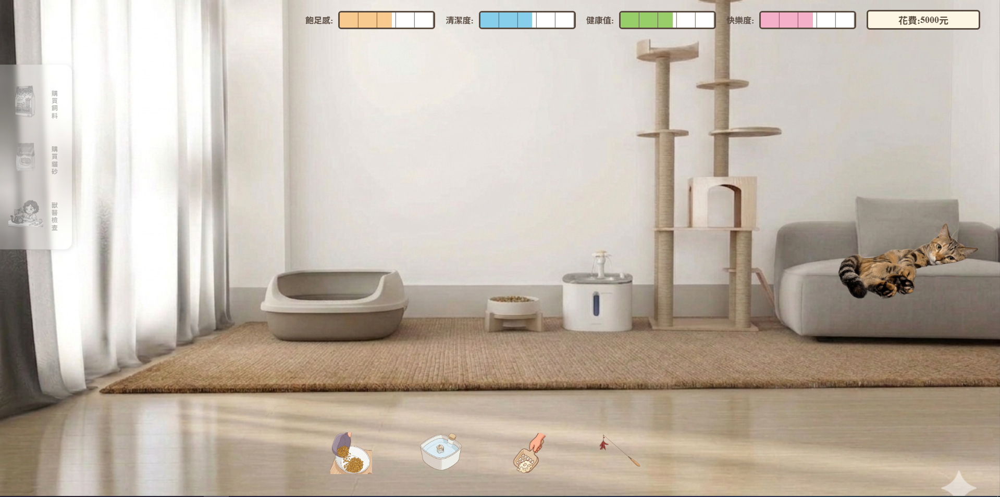

# How to feed a cat 🐱

一個以「新手養貓指南」為主題製作的靜態網站，整理養貓前需要了解的基本知識與注意事項。

## 📌 專案內容

網站包含養貓相關資訊與互動內容，希望用簡單、好閱讀的方式，幫助新手快速了解養貓的基本知識。

## 🖥️ 網站預覽

## 🌐 Demo

GitHub Pages：
[點此體驗網站](https://jhen-h.github.io/How-to-feed-a-cat/)

## 🛠 使用技術

* HTML
* CSS
* JavaScript
* GitHub Pages

## 📁 專案結構

* `index.html`：首頁
* `Index.css`：首頁樣式
* `Index.js`：首頁互動功能
* `report.html`：報告結果頁面
* `report.js`：結果頁面互動功能
* `img/`：圖片素材

## ✨ 專案目的

透過這個專案練習：

* HTML 網頁結構
* CSS 排版與視覺設計
* JavaScript 基礎互動
* Git / GitHub 版本控制
* GitHub Pages 靜態網站部署

## 📄 專案簡報

[查看完整專案介紹](./養貓網頁介紹.pdf)

